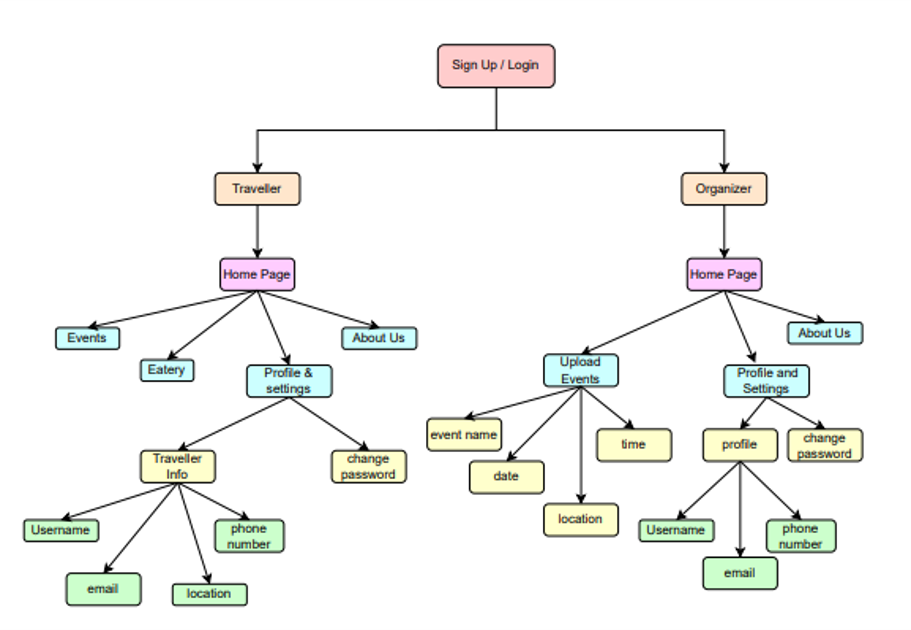
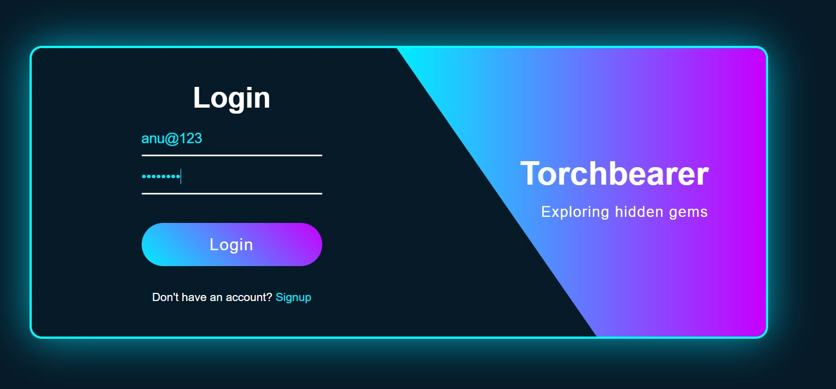
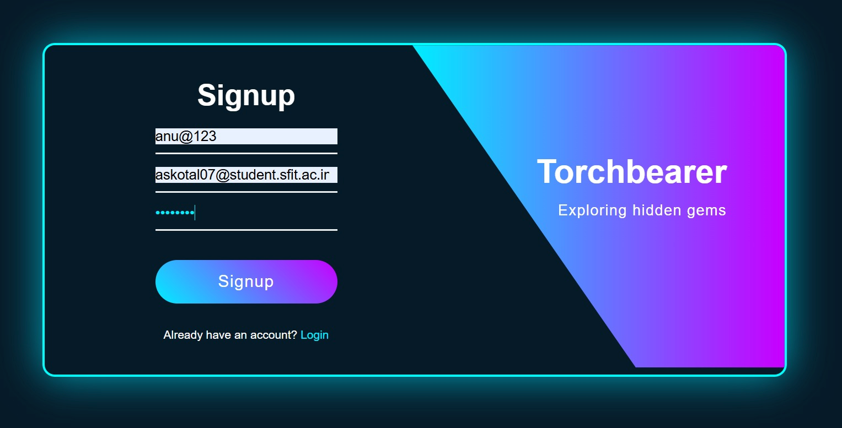
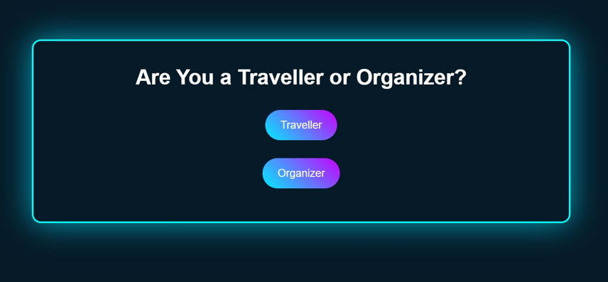

# TorchBearer — Event Discovery & Management Platform

A Java-based web application that connects event organizers and travellers through a centralized platform for event discovery, reservations, and event management.


---

## About

TorchBearer is an event discovery and management platform developed as an academic mini-project for the Department of Information Technology. It provides travellers with a convenient way to discover events, manage bookings, interact with event listings, and explore nearby eateries, while allowing organizers to publish and manage events.

The application provides separate functionalities for travellers and organizers through a role-based architecture, making event discovery and management accessible through a single web application.

## Features

### Traveller

- **User Authentication:** Register an account and log in to access traveller features.
- **Event Discovery:** Browse upcoming events and explore available activities.
- **Event Search:** Search for events and view relevant event information.
- **Event Reservations:** Book events and cancel existing reservations.
- **Event Interaction:** Like and comment on event listings.
- **Nearby Eateries:** Explore dining options around event destinations.
- **Restaurant Reservations:** Reserve tables at available eateries.
- **Profile Management:** Update personal information and change passwords.
- **Feedback System:** Submit feedback about the platform and its services.

### Event Organizer

- **Organizer Authentication:** Log in to access organizer-specific functionality.
- **Event Publishing:** Create event listings with descriptions and relevant details.
- **Event Image Uploads:** Add images to event listings.
- **Event Management:** View, update, and manage published events.
- **Profile Management:** Update organizer information and change passwords.
- **Feedback System:** Submit feedback about the application.
- **About Us:** Access information about the platform.

## Technology Stack

| Component | Technologies |
|---|---|
| Frontend | JSP, HTML5, CSS3, JavaScript |
| Backend | Java Servlets, JavaBeans, JDBC |
| Application Architecture | DAO (Data Access Object) |
| Database | MySQL |
| Web Server | Apache Tomcat 10 |
| Development Environment | Apache NetBeans |

## Project Structure

The project follows a Java web application structure, separating Java source code, web resources, configuration files, and project assets.

```text
TorchBearer/
├── assets/
│   ├── architecture.png
│   ├── login.png
│   ├── signup.png
│   └── role-selection.png
├── nbproject/
├── src/
│   ├── conf/
│   ├── java/
│   └── web/
├── README.md
└── ...
```

*Note: This is an illustrative structure. The actual directory names may differ depending on the project configuration.*

## System Architecture

The following diagram illustrates the high-level workflow of TorchBearer, from user authentication to role-specific functionality.

<p align="center">
  
</p>

### Application Workflow

```text
                   User
                     |
                     v
              Login / Signup
                     |
                     v
                Role Selection
                 /         \
                v           v
           Traveller     Organizer
                |           |
          Browse Events  Publish Events
          Search Events  Manage Events
          Book Events    Upload Images
          Explore Food   Update Profile
          Give Feedback  Give Feedback
                |           |
                +-----+-----+
                      |
                      v
                MySQL Database
```

The workflow represents the intended application flow. Actual database interactions and access controls depend on the implemented Java classes and configuration.

## Application Screenshots

### Login Page

<p align="center">
  
</p>

The login interface allows registered users to authenticate and access the platform.

### Sign Up Page

<p align="center">
  
</p>

The registration interface enables new users to create an account by providing the required information.

### Role Selection

<p align="center">
  
</p>

The role selection interface allows users to choose between Traveller and Organizer, providing access to the relevant application features.

## Core Functionalities

- User registration and login
- Role-based application interfaces
- Event creation and management
- Event discovery and search
- Event booking and cancellation
- Event likes and comments
- Nearby eateries and restaurant reservations
- User and organizer profile management
- Feedback collection

## Installation and Setup

### Prerequisites

Ensure the following software is installed:

- Java Development Kit (JDK) compatible with the project
- Apache NetBeans or another compatible Java IDE
- Apache Tomcat compatible with the project's Servlet and JSP APIs
- MySQL Server
- MySQL Connector/J JDBC driver

### 1. Clone the Repository

```bash
git clone https://github.com/bhoooomi05/TorchBearer.git
cd TorchBearer
```

### 2. Open the Project

Open Apache NetBeans and import or open the cloned project directory.

Check the project configuration to identify the correct web application root and build settings.

### 3. Configure the MySQL Database

Create the database using the name expected by the application:

```sql
CREATE DATABASE torchbearer;
```

If the repository contains a database export, import it into MySQL. For example:

```bash
mysql -u root -p torchbearer < database/torchbearer.sql
```

The command assumes that `database/torchbearer.sql` exists in the repository. Use the actual SQL file path if it differs.

If no database export is available, obtain the required schema and initial data before running the application.

### 4. Configure Database Connectivity

Locate the Java class responsible for database connectivity. It may be named `DatabaseConnection.java` or something similar.

Configure the connection URL, username, and password according to your local MySQL setup.

Example configuration:

```java
private static final String URL =
    "jdbc:mysql://localhost:3306/torchbearer";

private static final String USER = "root";

private static final String PASSWORD = "your_local_password";
```

Replace the example credentials with your own local settings. Do not commit real database passwords or other secrets to GitHub.

Ensure that MySQL Connector/J is included in the project's dependencies.

### 5. Configure Apache Tomcat

1. Add a compatible Tomcat server to your IDE.
2. Verify that the project's Java and Servlet API versions match the selected server.
3. Configure the application deployment settings.
4. Confirm that the database server is running.

### 6. Build and Run

Build the project in NetBeans and deploy it to Tomcat.

Open the application using the local URL assigned by the server. A typical URL might be:

```text
http://localhost:8080/TorchBearer/
```

The context path may differ depending on the deployment configuration.

## Security Considerations

The application should follow these practices when handling user accounts and database access:

- **Authentication:** Validate user credentials before granting access.
- **Password Security:** Store passwords using a suitable salted password-hashing algorithm rather than plain text.
- **Prepared Statements:** Use JDBC prepared statements to reduce SQL injection risks.
- **Session Management:** Manage user sessions securely and invalidate them during logout.
- **Role-Based Authorization:** Enforce permissions on the server side for traveller and organizer operations.
- **Credential Protection:** Keep database credentials and other secrets out of public repositories.
- **Input Validation:** Validate user input and uploaded files before processing them.

These are recommended security practices; their actual implementation should be verified against the source code.

## Future Enhancements

Potential enhancements that could extend TorchBearer include:

- **Online Payments:** Integrate a payment gateway for paid event reservations.
- **AI-Based Recommendations:** Suggest events based on user preferences and interests.
- **Interactive Maps:** Integrate mapping services to display event locations and nearby places.
- **Notifications:** Send booking confirmations and event reminders through email or SMS.
- **Mobile Application:** Develop Android and iOS applications for improved accessibility.
- **Social Media Integration:** Enable event sharing and social engagement.
- **Ratings and Reviews:** Allow attendees to rate events and share experiences.
- **Analytics Dashboard:** Provide organizers with insights into bookings and event engagement.
- **QR Code Check-In:** Support digital ticket verification at event venues.

## Learning Outcomes

The project provides practical experience in Java web application development, JSP and Servlet integration, JDBC connectivity, relational database management, session handling, and the organization of application logic using the DAO pattern.

It also demonstrates how separate user roles and reservation workflows can be incorporated into an event management platform.


<p align="center">
  <strong>TorchBearer</strong><br>
  Discover Events. Connect People. Create Experiences.
</p>

<p align="center">
  If you find this project useful, consider giving the repository a star.
</p>
